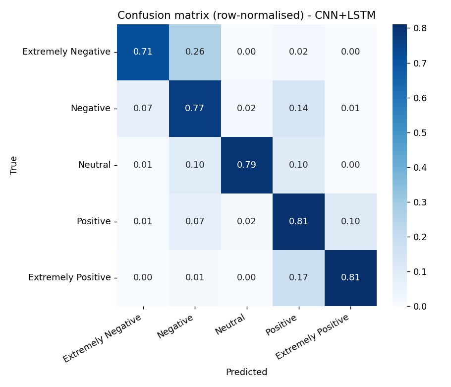

# COVID-19 Tweet Sentiment — deep learning vs. a strong linear baseline

**TensorFlow / Keras · scikit-learn · NLP**

Classifying the sentiment of ~45k tweets written at the start of the COVID-19 pandemic (March–April 2020) into five
classes, from *Extremely Negative* to *Extremely Positive*. The project compares four recurrent / convolutional
architectures with a TF-IDF + logistic-regression baseline under a clean protocol: early stopping uses a validation
split carved out of the training set, and the official test set is touched only once.

| | |
|---|---|
| **Data** | [COVID-19 NLP Text Classification](https://www.kaggle.com/datasets/datatattle/covid-19-nlp-text-classification) (Kaggle): 41,157 training tweets (16 March – 14 April 2020), 3,798 test tweets (2–16 March 2020) |
| **Best model** | Embedding → Conv1D → MaxPool → LSTM (1.4 M parameters, trains in under 2 min on a laptop CPU) |
| **Test accuracy** | **78.0 %** on 5 classes (macro-F1 0.79) · **86.6 %** on 3 classes (macro-F1 0.86) |
| **Context** | CPE Lyon deep-learning course project (2025), re-run and extended in 2026 |

## Results

All scores are on the official test set (3,796 tweets after cleaning).

| Model | 5 classes — accuracy | 5 classes — macro-F1 | 3 classes — accuracy | 3 classes — macro-F1 |
|---|---:|---:|---:|---:|
| TF-IDF (1–2-grams) + logistic regression | 54.2 % | 0.551 | 78.8 % | 0.755 |
| LSTM | 75.1 % | 0.761 | 85.6 % | 0.848 |
| BiLSTM | 76.6 % | 0.775 | 85.6 % | 0.845 |
| GRU | 77.3 % | 0.783 | 86.6 % | 0.856 |
| **CNN + LSTM** | **78.0 %** | **0.789** | **86.6 %** | **0.859** |

*3 classes = "Extremely Negative" merged into "Negative" and "Extremely Positive" into "Positive".*



## What I learned

- **Sequence models matter most for intensity.** On polarity alone (3 classes), the linear baseline is already at 79 %
  and the neural networks add 8 points. On five classes the gap grows to 24 points: telling *Negative* from
  *Extremely Negative* depends on word order and modifiers that a bag of n-grams does not capture.
- **Most remaining errors are between neighbouring intensities**: 26 % of *Extremely Negative* tweets are predicted
  *Negative*, and 17 % of *Extremely Positive* ones *Positive*. The main polarity error is *Negative → Positive* (14 %).
- **Architecture choice matters less than protocol.** The four networks are within 3 points of each other; the
  biggest change compared with the first version of this project came from no longer early-stopping on the test set,
  which had made the original numbers optimistic.
- **The test set is older than the training set** (early March vs. mid-March to mid-April), so the scores also
  measure some robustness to a shift in topics as the pandemic evolved.
- The small CNN front-end is both the most accurate and the fastest model: pooling shortens the sequence the LSTM
  has to read.

## Project structure

```
notebooks/01_exploration.ipynb   EDA: class balance, tweet length, examples per class, locations, posting dates
src/train.py                     cleaning, TF-IDF baseline, 4 Keras models, evaluation, figures
src/predict.py                   sentiment of new tweets with the saved model
results/                         metrics (JSON), classification reports, training logs, saved models
figures/                         confusion matrices and validation curves
```

## Run it

Download `Corona_NLP_train.csv` and `Corona_NLP_test.csv` from
[Kaggle](https://www.kaggle.com/datasets/datatattle/covid-19-nlp-text-classification) into `data/`, then:

```bash
pip install -r requirements.txt
python src/train.py                 # 5 classes, ~15 min on CPU
python src/train.py --classes 3
```

```bash
$ cd src && python predict.py "Supermarket shelves are empty again, people are panic buying everything, this is terrifying"
Extremely Negative  97%  Supermarket shelves are empty again, people are panic buying everything, this is terrifying
```

## Next steps

- Fine-tune a pre-trained transformer (DistilBERT / BERTweet) as the natural next baseline.
- Error analysis on sarcasm and mixed-sentiment tweets.

## Resumen en español

Clasificación del sentimiento de unos 45 000 tuits sobre el COVID-19 en cinco clases. Comparo cuatro redes neuronales
(LSTM, BiLSTM, GRU, CNN+LSTM) con una referencia TF-IDF + regresión logística, con un protocolo limpio de
entrenamiento, validación y prueba. El mejor modelo alcanza un **78 %** de exactitud en 5 clases y un **86,6 %** en 3
clases; la mayoría de los errores se producen entre intensidades vecinas (p. ej., *negativo* frente a *muy negativo*).
